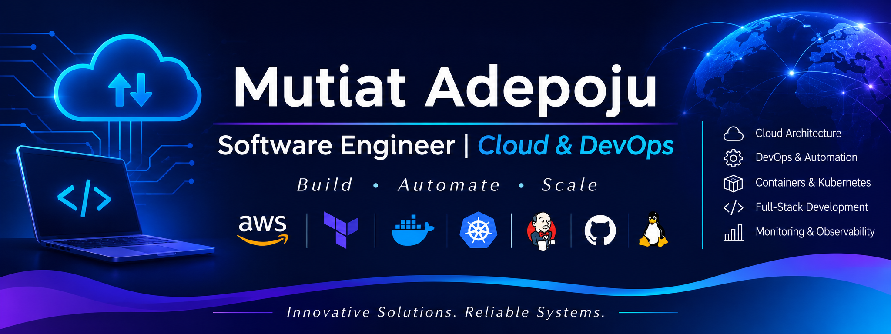

  

# Hi, I'm Mutiat Adepoju

<h1 align="center">Hi, I'm Mutiat Adepoju 👋</h1>

<h3 align="center">Software Engineer | Cloud & DevOps</h3>

  <a href="https://linkedin.com/in/mutiat-adepoju">LinkedIn</a> •
  <a href="https://github.com/Rike12">GitHub</a> •
  <a href="https://riike.hashnode.dev">Hashnode</a> •
  <a href="mailto:mutiat900@gmail.com">Email</a>

---

## About Me

I'm a software engineer with over two years of professional experience building web applications, alongside experience in Cloud and DevOps engineering.

My journey started with frontend development, where I learned to build responsive and user-friendly applications. Since then, I've worked on projects across fintech, e-commerce and business platforms, using technologies such as React, Next.js and TypeScript.

As I gained experience, I became increasingly interested in what happens behind the scenes: how applications are deployed, how infrastructure is managed and how development processes can be made more efficient.

This led me to develop my skills in AWS, Terraform, Docker, Kubernetes and CI/CD automation. I've applied these technologies through practical training and my current work at Amdari.

I enjoy learning, solving problems and working with people who are passionate about building useful technology. I'm particularly interested in Cloud Engineering, DevOps, automation and reliable software delivery.

---

## Technical Skills

**Cloud & Infrastructure**
- AWS
- Terraform
- Infrastructure as Code
- Linux
- Networking Fundamentals

**Containers & Orchestration**
- Docker
- Kubernetes
- Helm
- Deployments, Services, Ingress and Secrets

**CI/CD & Automation**
- Jenkins
- GitHub Actions
- Git
- Bash
- Python
- Automated Build and Deployment Workflows

**Monitoring & Troubleshooting**
- Prometheus
- Grafana
- OpenTelemetry
- Linux Troubleshooting

**Software Development**
- JavaScript
- TypeScript
- React.js
- Next.js
- Vue.js
- HTML5
- CSS3
- Tailwind CSS
- REST API Integration

**Development Tools & Practices**
- Git and GitHub
- Pull Requests
- Code Reviews
- Agile/Scrum
- Technical Documentation
- Team Collaboration

---

## What I Work On

**Cloud Infrastructure**

Working with AWS and Terraform to provision and manage infrastructure, with an interest in building organised, repeatable environments.

**CI/CD and Automation**

Using Jenkins and GitHub Actions to support automated software build, testing and deployment processes.

**Containers and Kubernetes**

Working with Docker to package applications and Kubernetes to deploy and manage application workloads.

**Monitoring and Troubleshooting**

Developing my experience with Prometheus, Grafana and OpenTelemetry, alongside Linux-based troubleshooting.

**Software Development**

Building responsive web applications and integrating APIs using React, Next.js, TypeScript and JavaScript.

---

## Featured Projects

I use GitHub to share my development work, practise new technologies and document what I learn.

Some of my frontend development work includes:

- **Tech Care Dashboard** – A dashboard project focused on presenting information through a user-friendly interface.
- **NewsHub** – A news-related web application.
- **Portfolio Website** – A personal web development project.
- **React Applications** – Projects demonstrating frontend development and reusable components.

I'm also working towards building a stronger collection of Cloud and DevOps projects covering:

- AWS infrastructure provisioned with Terraform.
- Automated CI/CD pipelines using GitHub Actions.
- Docker-based application builds and deployments.
- Kubernetes deployments and application management.

I'll continue adding practical projects with clear documentation, setup instructions and examples.

---

## Professional Experience

### DevOps & Cloud Engineering Intern
**Amdari | United Kingdom | September 2026 – Present**

- Support software build and deployment workflows using Jenkins and GitHub Actions.
- Work with AWS and Terraform to provision cloud infrastructure.
- Use Docker to package applications and support deployments in Kubernetes environments.
- Work with Kubernetes Deployments, Services, Ingress and Secrets.
- Investigate deployment and infrastructure issues using Linux tools, Git and networking fundamentals.
- Contribute to cloud infrastructure and deployment activities while developing my practical experience.

### Previous Software Development Experience

Before moving into Cloud and DevOps, I worked as a Frontend Engineer across several software development teams.

**Earlybean | September 2025 – December 2025**
- Built financial applications and money management dashboards using React, Next.js and TypeScript.
- Integrated REST APIs for authentication and payment functionality.
- Collaborated with backend developers and supported software releases.

**Intelligra | June 2025 – September 2025**
- Developed e-commerce interfaces and Buy Now, Pay Later features.
- Integrated APIs for authentication, credit checks and instalment plans.
- Fixed application issues and contributed to performance improvements.

**KayBill Technologies | December 2024 – May 2025**
- Developed features for a B2B e-commerce platform, including vendor dashboards and product listings.
- Used Git branches and pull requests to collaborate with other developers.
- Improved application layouts for desktop and mobile devices.

**Midra Solution Limited | May 2024 – November 2024**
- Developed user interfaces for business workflow applications using React and REST APIs.
- Built reusable components to support maintainable applications.
- Collaborated with team members on code reviews and software releases.

---

## Training & Professional Development

### Cloud & DevOps Engineering Bootcamp
**10Alytics | April 2026 – September 2026**

Completed practical training covering cloud infrastructure, application deployment and automation.

Areas covered included:

- AWS infrastructure provisioning using Terraform.
- CI/CD pipelines with Jenkins and GitHub Actions.
- Application containerisation with Docker.
- Kubernetes deployments, Services and Ingress.
- Helm for managing Kubernetes applications.
- Monitoring and observability using Prometheus, Grafana and OpenTelemetry.

### Frontend Development Training
**HerTechTrail Academy & Instinct Hub | April 2023 – September 2023**

Completed frontend development training, building foundational knowledge and practical skills in web development.

Training covered:
- HTML and CSS.
- JavaScript.
- Responsive web development.
- Frontend development fundamentals.

---

## Education

**MSc Management**  
BPP University, United Kingdom | May 2025 – September 2026

**BSc Zoology**  
Ahmadu Bello University, Zaria, Nigeria | September 2012 – October 2016

---

## Volunteering & Mentoring

### Volunteer Technical Mentor
**Young Women Code | Lagos, Nigeria | October 2023 – April 2025**

- Supported junior developers through practical programming exercises.
- Helped facilitate workshops on software development and problem-solving.
- Provided guidance on debugging and code reviews.

---

## Technical Writing

I enjoy researching technology and sharing what I learn through practical articles and tutorials.

I write about software development, programming concepts and technology in a way that makes them easier to understand.

**Read my articles on Hashnode:**

---

## GitHub Activity

  
  

---

## Let's Connect

I'm always happy to connect with people in software development, Cloud and DevOps, exchange ideas and learn from others.

  
  
  

  <i>Learn. Build. Automate. Keep improving.</i>

  Thanks for visiting my profile! 😊

